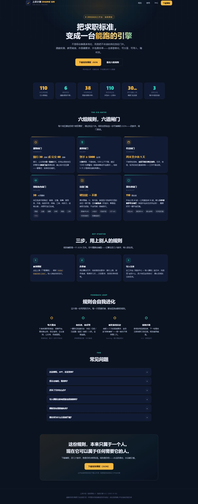

# 上岸计划 · 国内求职自动化工作流

> 一套把「散落在 8+ 渠道的招聘信息」自动聚合成「每日可投递岗位清单」的求职自动化系统。
> 采集 → 过滤 → 实测 → 推送，四步流水线，每天自动运行。

## 它解决什么问题

招聘信息极度分散：同一个岗位可能只在 BOSS 发、只在公众号发、或只在某地人社局官网发。
想找 AI 方向岗位，要在 BOSS / 智联 / 51job / 猎聘 / 公众号 / 政企官网之间反复切换，
信息来源很多但**不集中、不具体、还夹着大量外包和已关闭岗位**。

本系统把采集、过滤、实测、推送、复盘做成一条自动化流水线：

- 多渠道采集：四大招聘平台（登录态复用）+ 政企 / 高校就业 / 应届生站 / 公众号 / 企业官网
- 规则过滤：作息、薪资、外包黑名单、岗位方向、应届身份等全部可按模板自定义
- 通勤实测：接入高德 API，按「骑行 / 公交 / 地铁」真实测距，不达标不推
- 闭环推送：写入飞书多维表格岗位库 + 每日飞书卡片，投递状态可回写、可复盘
- 投递反馈学习：婉拒 / 已读不回会沉淀进规则，越用越懂你
- 可选 AI 打招呼语：接入 DeepSeek（或任意 OpenAI 兼容 API），按岗位生成私信打招呼语 + 简历一句话摘要；不配 Key 自动用模板兜底

## 架构

```
┌─────────────────────────────────────────────────────────┐
│  🧠 调度编排（脚本流水线 · 可选 LLM 打招呼语）             │
├─────────────────────────────────────────────────────────┤
│ ⏰ 调度层    每日07:30/14:30推送 · 每日补推检查 · 每周复盘  │
│ 📡 感知层    四大平台(登录态看门狗) + 公开渠道(政企/高校/…) │
│ 🧮 决策层    详情深度解析 → 规则引擎 v5.2 → 反馈学习         │
│ ⚡ 行动层    高德通勤实测 → 时效验证 → 增量去重 → 写表发卡   │
│ 💾 记忆层    飞书多维表格 · SQLite · 登录台账 · 推送历史     │
│ 🖥️ 界面层    本地工作台(localhost:8123) · 发布网页版 · 卡片  │
└─────────────────────────────────────────────────────────┘
```

## 目录结构

```
shangan-plan/
├── agent/        # 决策与推送层（规则引擎、流水线、通勤、反馈学习、可选AI打招呼语）
├── scraper/      # 采集层（公开渠道抓取、详情解析、登录态看门狗）
├── workbench/    # 界面层（本地工作台 Web 应用 + 规则模板）
├── samples/      # 示例数据（脱敏后的规则回归用例）
└── docs/         # 架构 / 快速开始 / 规则指南 / 测试 / 免责声明
```

规则模板展示页（`workbench/rules-showcase/` 由模板自动生成）：



## 快速开始（3 步）

1. **克隆本仓库**，确认本机已装 Python 3.10+
2. **配置四件套**（详见 [docs/QUICKSTART.md](docs/QUICKSTART.md)）：
   - 飞书多维表格（base_token / table_id，存岗位库）
   - 高德开放平台 Web 服务 Key（通勤实测）
   - 四大招聘平台登录态（可选，未登录则自动跳过该渠道并如实标注）
   - 按 `workbench/rules-template.json` 复制一份你自己的规则
3. **跑通 Demo**：

```bash
# ① 用示例规则 + 示例数据试跑过滤（不需要任何 Key）
cd agent
python filter.py --data ../samples/golden.example.json --summary

# ② 启动本地工作台（浏览器打开 http://localhost:8123）
cd ../workbench
python server.py
```

> 完整链路（抓取 → 解析 → 通勤 → 推送）的逐步骤说明见 [docs/QUICKSTART.md](docs/QUICKSTART.md)。

### （可选）AI 打招呼语

```bash
# 复制 config.example.json 为 config.json，填入 llm.api_key（DeepSeek 或任意 OpenAI 兼容 API）
# 单条：
python agent/greeting.py --title "AI训练师" --company "某公司" --salary "10-15K" --keywords "AIGC,标注"
# 批量（jobs.json 为岗位数组）：
python agent/greeting.py --file jobs.json --out greetings.json
# 不配置 Key：自动用模板兜底，功能仍可用
```

## 开源坦白（请先读）

- 本项目是**个人求职工作流的开源分享**，不是成熟产品：0 Star 起步，未经过大规模使用验证
- 核心过滤是**确定性规则引擎**（if-else），不是大模型；「AI 打招呼语」是可选功能，需自备 LLM API Key
- 国内招聘平台的接口与页面**随时可能变更导致采集失效**，一切以真实抓取结果为准，失效渠道会如实标注
- 「去投递」是跳转到平台手动投递，**不包含自动批量投递**（规避封号与法律风险，也意味着你仍需自己点按钮）
- 欢迎提 Issue / PR 一起改进，[docs/TESTING.md](docs/TESTING.md) 里有现成的测试任务卡

## 设计要点

- **宁缺毋滥**：0 条达标就 0 条，绝不硬凑；已关闭岗位绝不推送；外包公司坚决排除
- **可审计**：每个数字来自真实抓取与验证，平台不可用如实标注受限原因
- **规则可模板化**：`workbench/rules-template.json` 是面向非技术用户的规则模板，导出 / 导入 / 使用见 [docs/RULES_GUIDE.md](docs/RULES_GUIDE.md)

## 如何测试它

三层次测试法（录屏演示 / 网页体验 / 真跑代码）+ 现成测试任务卡，见 **[docs/TESTING.md](docs/TESTING.md)**。

## 免责声明

- 本项目的抓取能力仅用于**个人求职信息聚合**，请遵守各招聘平台的服务条款与 robots 约定，控制访问频率
- 项目本身免费、无内置云依赖；若启用 AI 打招呼语，需自行申请 DeepSeek 等 LLM API Key（按量付费）
- 规则与示例数据均为**示例**，请勿直接用于真实决策
- 详见 [docs/DISCLAIMER.md](docs/DISCLAIMER.md)

## License

[MIT](LICENSE)
